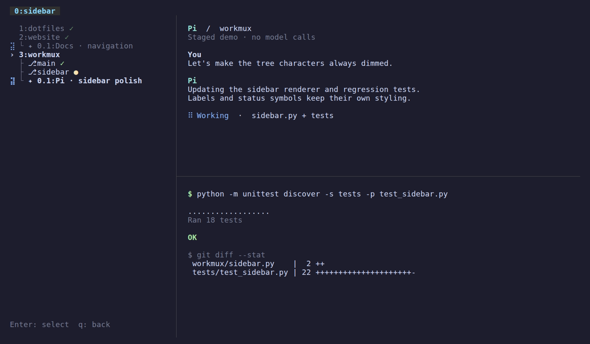

# workmux

Keep projects, Git checkouts, and agent activity visible in a tmux sidebar.
Workspaces are enabled tmux sessions, tabs are windows, and each window gets a
left sidebar beside your ordinary terminal panes.

Start tmux with your normal configuration, then enable workmux in the sessions
you choose. Optional Pi, OpenCode, Codex, and Claude Code integrations add
agent-state indicators and desktop notifications.



*Isolated demo with simulated agent activity and terminal output.*

## Requirements

- Python 3.10 or newer, with `curses`.
- tmux 3.8 or newer.
- The installed `workmux` command must be on tmux's `PATH`.

The Python package installs its Tree-sitter dependencies automatically. Agent
harnesses are needed only for their optional integrations; desktop notifications
additionally require a compatible terminal.

## Install

Choose either pipx or Nix; you do not need both.

### pipx

Install from a local clone with [pipx](https://pipx.pypa.io/). From the repository
root, run:

```sh
pipx install .
# To reinstall after updating the source:
pipx install --force .
```

This project is not published to PyPI; use the local repository path. pipx installs
the Python dependencies, but tmux must already be installed separately. Ensure
pipx's application bin directory is on your `PATH`.

### Nix

With Nix's `nix-command` and `flakes` features enabled, run from the repository root:

```sh
nix profile add .
# To update the profile entry after updating the source:
nix profile upgrade workmux
```

On older Nix versions, use `nix profile install .` instead of `nix profile add .`.
The flake supplies Python, its dependencies, and tmux, pinned by `flake.lock`.
Ensure your Nix profile's `bin` directory is on tmux's `PATH`. Nix outputs are
provided for `x86_64-linux` and `aarch64-linux`.

To build without changing your profile, use `nix build`; the command is then
available at `./result/bin/workmux`.

After updating either installation, see [Upgrading and troubleshooting](#upgrading-and-troubleshooting)
to restart existing sidebars.

## Optional tmux configuration

Want workmux enabled automatically? Add the activation hook below to your tmux
config (`~/.tmux.conf`, or your usual config path). The example also includes a
manual activation key and optional navigation, sidebar, and notification settings.
Copy the parts you want into your existing config; do not replace it wholesale.

<details>
<summary>Commented ~/.tmux.conf example</summary>

```tmux
# workmux must be on the tmux server's PATH.
# Put this after plugins that define your window/split/layout bindings.

# Automatically enable newly created sessions, including the first one.
# Choose another hook index if 90 is already in use.
set-hook -g after-new-session[90] 'run-shell -b "workmux --socket \"#{socket_path}\" enable --pane \"#{pane_id}\""'

# Prefix, Shift+w: enable this session, or re-enable after reloading config.
# Choose another key if W is already in use.
bind-key W run-shell -b 'workmux --socket "#{socket_path}" enable --pane "#{pane_id}" --client "#{client_name}"'

# Optional: click sidebar rows and scroll with the mouse wheel.
# set -g mouse on

# Optional: return focus immediately from the sidebar to content.
# Mouse navigation still works, but sidebar keyboard navigation is unavailable.
# Leave this off for Up/Down or j/k navigation inside the sidebar.
# set -g focus-events on

# Optional: preferred sidebar width and checkout discovery depth (defaults: 36, 6).
# set -g @workmux-sidebar-width 30
# set -g @workmux-checkout-max-depth 3

# Optional prefix bindings; these replace any existing bindings for these keys.
# Up/Down includes all tmux sessions, not only workmux workspaces.
# bind-key Up switch-client -p
# bind-key Down switch-client -n
# bind-key Left previous-window
# bind-key Right next-window
# bind-key s run-shell -b 'workmux --socket "#{socket_path}" sidebar toggle-focus --pane "#{pane_id}"'

# Agent attention/finished indicators need native alerts; monitor-bell defaults on.
# set -g monitor-bell on

# Optional: desktop notifications from installed agent integrations.
# Requires OSC 9 support and notification permissions in your terminal/desktop.
# 'all' includes hidden panes; 'on' permits visible panes only.
# Passthrough allows arbitrary terminal controls: enable only for trusted workloads.
# set -g allow-passthrough all

# Optional: activity symbols beside tab names. Uncomment both lines.
# These replace your window formats; adapt them if you already customize the bar.
# set -g window-status-format ' #{?#{&&:#{==:#{@workmux},1},#{@workmux-agent-indicator}},#{@workmux-agent-indicator} ,}#I:#W#F '
# set -g window-status-current-format ' #{?#{&&:#{==:#{@workmux},1},#{@workmux-agent-indicator}},#{@workmux-agent-indicator} ,}#I:#W#F '
```

</details>

Reload your config normally (for example, `tmux source-file ~/.tmux.conf` if that
is your config path), then run `workmux enable` or press prefix, Shift+w in each
existing session you want to enable. The hook enables new sessions only. If
plugins replace bindings asynchronously, re-enable after they finish.

## Enable in your existing tmux session

Start tmux normally. Inside a terminal pane, run:

```sh
workmux enable
```

Workmux adds a sidebar to each window in **only that session**, without restarting
content processes. It preserves your current window, active panes, zoom, session
names, prefix, status styling, mouse settings, and existing hooks.

It reads your running tmux configuration and adapts supported window-creation,
split, and layout bindings to leave room for the sidebar. The same bindings keep
their original behavior in other sessions. No config files are edited; startup
hooks and additional keybindings are opt-in.

Repeat `workmux enable` in other sessions to list them as workspaces. After
reloading your tmux config, run it again to update binding adaptations and add
missing sidebars without duplicating existing ones.

**Current limitations:** one attached client per session is supported. Sessions
sharing windows with other sessions cannot be enabled. There is no disable/restore
command yet.

## Navigation and layouts

Your existing keys remain in effect. With stock tmux bindings:

| Key sequence | Action after enabling |
| --- | --- |
| prefix, c | Create a tab with a sidebar |
| prefix, % / prefix, " | Split content right / down |
| prefix, Alt+1–5 | Apply a standard layout to content |
| prefix, Space | Cycle layouts |
| prefix, E | Balance adjacent content panes |

Newer tmux versions also bind Alt+6–7 to mirrored layouts. Workmux adapts the
bindings you have; it does not add missing keys. Use `workmux layout --help`
for all available layouts.

Click a workspace in the sidebar if tmux mouse support is enabled. The current
workspace is bold and marked with `›` next to the status gutter. When exactly one
client is attached to the current workspace, `-` marks the listed workspace that
`switch-client -l` would return to. Other workspaces and their child rows are
dimmed, but the `-` and gutter symbols stay undimmed. Tree branches are always
dimmed. Selection restores the destination session's selected tab.

Workspaces are ordered by session name and labeled `<index>:<session-name>`,
for example `1:workmux`. These 1-based positions can change when sessions are
added, removed, or renamed; they are not tmux session IDs.

With `focus-events` off (tmux's default), focus the sidebar using ordinary pane
navigation, then use Up/Down or j/k and Enter. Escape/q returns to the previous
content pane. Keyboard navigation scrolls to keep the selection visible.

With `focus-events` on, focus returns immediately to the previous content pane
when the sidebar gains focus. Clicking and scrolling still work, but keyboard
navigation inside the sidebar is unavailable. Workmux leaves this option
unchanged; tmux may require detaching and reattaching after you change it.

With tmux's `mouse` option enabled, the wheel over the sidebar scrolls three rows
at a time without changing focus or activating a row. Click a visible row to
select it; keyboard navigation resumes following the selection. Wheel support
also depends on your terminal and curses build.

### Layouts

Retiling affects only content; the sidebar stays full-height at the left edge.
It preserves pane processes and focus, exits zoom, and can repair a sidebar
misplaced by a raw tmux layout command. Mirrored layouts retain the same main
content pane. `main-pane-width` and `main-pane-height` are honored, with percentages
relative to the content area; other native layout tuning options are unsupported.

Balancing (`select-layout -E` or `workmux layout balance`) keeps the existing
split structure and focus rather than applying a preset. It does not change the
layout remembered for cycling or spread the sidebar with content. Pane border
status is honored, but balancing with pane scrollbars enabled is rejected; use
a named preset instead.

### Checkouts and worktrees

A workspace can be a repository or a directory containing several repositories
or worktrees. Discovered checkouts appear as `⎇` rows labeled with the directory
basename. Checkouts and agents are direct children of the workspace:

```text
 ›1:job
↑ ├ ⎇ backend
  ├ ⎇ frontend
⣷ ├ ✦ 1.0:coordinate
⣷ ├ ✦ 2.0:implement
▲ └ ✦ 3.0:review
```

Checkout labels may repeat when directories share a basename; each row still
targets its own full checkout path.

Select a checkout to open a tab in that directory **within the parent workspace**.
Later selections focus the same tab, even after renaming it or changing its shell
directory. Closing the tab allows the next selection to open a fresh one.
Discovery itself creates no tabs, repositories, branches, or worktrees.

Discovery runs in the background, normally every five seconds, up to six levels
below the saved workspace directory, including inside existing checkouts. It
recognizes repositories and linked worktrees without relying on naming conventions.
Worktrees outside the workspace and discovered directory symlinks are excluded;
file contents and `.git` contents are not scanned. Large trees may be only
partially listed. Paths containing tabs or newlines are unsupported.

<details>
<summary>Discovery scan limits</summary>

Each scan is limited to 2,000 directories, 16,000 directory entries, 128 Git
queries, 64 checkouts, and four seconds. Increasing the depth does not raise
these limits.

</details>

Set the maximum depth globally or override it for one workspace session:

```sh
tmux set-option -g @workmux-checkout-max-depth 6
tmux set-option -t my-workspace @workmux-checkout-max-depth 3
```

Changes trigger a new background scan without restarting sidebars. Depth counts
directory levels below the saved workspace directory: `worktrees/team/backend`
is depth 3. A value of `0` disables discovery below the workspace root. Unset,
negative, or invalid values use the default of 6. Higher depths remain subject
to the other scan budgets.

Every checkout has its own Git status. The workspace's Git status still refers
only to its saved directory, not an aggregate of nested repositories.
Removing a checkout removes its discovered row, **not its live tabs or content**.
Agent rows remain direct children of the workspace. Workmux does not manage
pushes, pull requests, or checkout cleanup.

### Git status

Workspace and checkout rows show the checked-out branch after a single space,
for example `1:workmux` *main* or `└ ⎇ api` *feat/login*. A detached HEAD shows
its seven-character commit ID instead. If the sidebar's terminal doesn't
advertise italic support, it puts the suffix in parentheses. Non-Git directories
show no suffix. In a narrow sidebar the suffix is shortened or hidden before the
name is truncated.

Rows also show at most one Git symbol in the undimmed left gutter, for example
`↑›1:workmux` for the current workspace. Workspace Git information uses the saved
directory (the content pane directory when first enabled), not the shell's current
directory. Checkout rows use their own checkout directory.

Color shows repository status: **red** for conflicts, otherwise **amber** for
local changes (including staged or untracked files), otherwise **blue** for clean.
The symbol shows how the branch compares to its upstream:

| Symbol | Upstream status |
| --- | --- |
| `~` | No divergence, or no configured upstream |
| `↑` | Commits to push |
| `↓` | Commits to pull |
| `↕` | Commits to push and pull |

For example, an amber `↑` means local changes and commits to push. A clean repo
with no divergence shows no symbol. Non-Git folders and unavailable or failed
checks also show no symbol. Git is optional and must be on the sidebar process's
`PATH`. Amber falls back to yellow on basic color terminals; terminals without
color support show plain symbols.

Checks run in the background, normally every two seconds, without fetching or
refreshing Git's index on disk. Sidebars on the same tmux server share checkout
discovery and Git status results. If the sidebar doing the checks closes, Git
indicators and checkout rows may briefly disappear while another sidebar
refreshes them. Ahead/behind compares against the locally known upstream, so it
may be stale until you fetch. Slow checks time out and do not block sidebar
navigation.

### Activity tree

Agent panes and tabs with native tmux alerts appear beneath their workspace,
alongside checkouts:

```text
 ›1:project-a
♥ ├ ✦ 1.0:build
▲ └ ✦ 2.0:review
  2:project-b
▲ ├ ✦ 1.0:changes
▲ └ 2:logs
```

| Indicator | Color | State |
| --- | --- | --- |
| `♥` | Red | Agent working |
| `▲` | Red | Agent needs attention: a blocking input dialog, error, or interruption |
| `▲` | Green | Agent finished its run |
| `▲` | Amber | Other tmux alert: bell, monitored activity, or silence |

Agent status and native alert symbols occupy the left gutter and aren't dimmed
by inactive workspaces. Amber falls back to yellow on basic color terminals.
Without color support the triangles look the same. On terminals that support
dim text, the red heart repeats a double beat every second: dim for 700 ms,
bright for 100 ms, dim for 100 ms, bright for 100 ms. The `✦` identifies an
agent row. Each active agent pane gets its own row, even when several share a
tab. Selecting one focuses that pane, including in another workspace.

Labels use `window.pane:title`, for example `2.1:build`, using the pane's terminal
title or falling back to the tab name. Rows follow window-index order beneath
checkouts; within a tab, attention comes before working, then finished. Renaming
or rearranging panes does not break navigation. Idle tabs without alerts are hidden.

**Attention and finished states require a pending tmux alert.** Clearing the alert
hides those rows; working agents remain visible without an alert. Other native
alerts appear when there is no applicable agent state. Workmux preserves tmux's
normal alert monitoring and clearing behavior.

Install an [agent integration](#optional-agent-integrations) for automatic reports.
Agent states are explicitly reported, not guessed from running commands; stale
reports are ignored when the integration supplies a process ID. Native tmux
alerts need no integration, but their monitoring settings remain your responsibility.

### Closing tabs and workspaces

When the last content pane in a tab closes, workmux closes the whole tab,
including its sidebar. If the tab is linked to other tmux sessions, it closes in
all of them. Other tabs stay open. Closing a workspace's final tab ends the
workspace; no shell is respawned.

This also applies when the last shell exits naturally or is closed with tmux's
pane-kill command. Cleanup happens on the sidebar's next refresh, normally within
400 ms. Your tmux settings still apply: `remain-on-exit` can retain a dead content
pane, `renumber-windows` controls whether the remaining tabs are renumbered, and
`detach-on-destroy` controls whether a client detaches or switches to another
session when the workspace ends.

## CLI helpers

```sh
workmux workspace list
workmux workspace new project-b --dir /path/to/project-b
workmux workspace select project-b
workmux workspace select --index 3
workmux tab new editor
workmux split right
workmux split down
workmux layout tiled
workmux layout next
workmux layout balance
workmux sidebar toggle-focus
```

Inside tmux, commands default to its server. Outside tmux, the default server is
named `workmux`. Explicit `--server NAME` or `--socket PATH` overrides inference
and must appear before the subcommand. Pane-oriented commands accept `--pane ID`.
`workspace select` requires an attached client. Its `--index N` refers to the
workspace's 1-based sidebar position, not a tmux ID or a checkout/agent row.
Prefer names or IDs in scripts, since positions can change. A positional numeric
target selects a workspace with that name.

Run `workmux --help` or a subcommand's help for full syntax and JSON output options.

### Bash tab completion

Nix builds include completion support. With pipx, install from the repository
root with `pipx install '.[completion]'` (add `--force` to update an existing
installation). Enable completion in Bash with:

```bash
source <(workmux completion bash)
```

Add that line to `~/.bashrc` to enable it in future shells. Tab completes
subcommands, flags, fixed choices, and paths. It also offers live workspace
names and indexes, pane IDs, and attached clients. It follows the command's
server selection: pass `--server` or `--socket` before the subcommand to query a
different server. Completion never starts a tmux server or runs a workmux action.

### Create a workspace interactively

Run `workmux workspace new --interactive` in a terminal with Python's `readline`
module. Tab completes directories, `~` expands, and spaces in paths don't need
quotes. The directory prompt starts with `.` (or the `--dir` value) already
filled in. Edit it or press Enter to accept it. Workmux uses the resolved
directory's basename unless that name is taken or invalid. Missing directories
are created after the prompts. Ctrl-C cancels.

If the default name is in use, the name prompt starts with it filled in. Press
Enter to reopen the workspace when the name and directory match. If the name is
taken by a different workspace or a native tmux session, edit it.

On the current tmux server, the interactive command switches the invoking
session's client to the workspace. It requires exactly one attached client in
that session. Outside tmux, add `--attach` to open the workspace; otherwise the
command does not attach a client.

To open the prompts in a tmux popup, optionally add this alias to your tmux
config (choose another index if 100 is in use):

```tmux
set -s command-alias[100] 'wn=display-popup -EE -T "New workspace" -d "#{pane_current_path}" workmux workspace new --interactive'
```

Press prefix, then `:`, type `wn`, and press Enter. The popup starts in the
active pane's directory; directory completion works inside the popup, not at
tmux's `:` prompt.

### Start a Pi team in the current tab

From the foreground shell in a workmux tab with a sidebar and exactly one live
content pane, run `workmux team new`. Put `pi` on that shell's `PATH`
first; no workmux agent plugin is required. The command doesn't run from a
popup, a key binding, or an already-running Pi session.

Workmux leaves the sidebar in place and starts Pi in three side-by-side content
panes: master, slave 1, and slave 2. The master is the original pane and keeps
focus. All three sessions start in the shell's current directory and share the
same files, but not chat history. Workers use the tmux session environment with
the invoking shell's `PATH`. There is no automatic delegation or edit isolation.

Run `workmux team status` from the tab to see the role assignments. They follow
pane IDs, not pane positions or running processes. Exiting the master Pi returns
you to the original shell without stopping the other sessions. Closing a role's
pane or moving it to another tab marks it missing. `workmux team clear` forgets
the assignments without closing any panes; close extra panes before creating
another team in that tab.

#### Replace managed workers between phases (Linux)

Managed workers require Linux with `/proc` and pidfd support. With a trusted
worker launcher and the workmux Pi extension installed or updated
(`workmux install pi`), opt in from the foreground shell:

```sh
workmux team new --launcher /path/to/launch-worker --profile design
```

Workmux saves the launcher and the shell's current directory and waits for both
workers to register before starting the master. The launcher receives the
profile as one literal argument, plus `WORKMUX_TEAM_ROLE` (`slave 1` or
`slave 2`) and a unique `WORKMUX_TEAM_LAUNCH_ID` in its environment. Have it
start a fresh interactive Pi in the foreground, preserving `TMUX`, `TMUX_PANE`,
and `WORKMUX_TEAM_LAUNCH_ID`. Workers need `tmux` on their `PATH` and access to
the socket and the installed extension. Their processes must be visible from
the host. Use the profile to define any per-phase directory restrictions;
workmux does not sandbox the launcher or the workers.

From the master pane (including Pi's `bash` tool):

```sh
workmux team status --json
workmux team reset --profile implementation
```

Reset stops both old workers before starting their replacements in the same
panes. It does not restart the master or retile the tab. Workers can hand off
work through shared files rather than carrying over chat history. The launcher
must not leave background jobs behind: workmux checks that pane leaders and
registered Pi processes exit, not that every descendant has stopped.

Successful reset prints a JSON object such as `{"slave 1": 172, "slave 2": 173}`.
Status prints the same object for a complete, current pair, or `null` when no
pair is available. Registration means Pi started, not that another extension
or messaging service is ready. The PIDs describe a snapshot, not a guarantee
that the workers are still running when you use them.

A failed reset reports diagnostics on stderr without a partial pair. You can
retry explicitly if workmux can still verify pane ownership and teardown. It
refuses to replace a missing or repurposed worker, including after an
interruption that leaves ownership or teardown uncertain. `team clear` only
forgets the team; it does not stop any process.

#### Mark team windows in the status bar

To display `∴` instead of the window name when a team is assigned, add this to
`~/.tmux.conf`:

```tmux
set -g window-status-format ' #I:#{?@workmux-team,∴,#{window_name}}#F '
set -g window-status-current-format ' #I:#{?@workmux-team,∴,#{window_name}}#F '
```

The window index and native tmux flags stay visible: `2:∴*` is the current
window, and `2:∴-` is the previously selected window. This does not rename
windows; `workmux team clear` brings back the normal label. If you already
customize the formats, replace just `#W` with `#{?@workmux-team,∴,#{window_name}}`
to keep your styles and activity indicators.

#### Show team roles on pane borders

To show `[master]` and similar labels on team panes, add this to `~/.tmux.conf`:

```tmux
set -g pane-border-status top
set -g pane-border-format '#{?#{E:@workmux-team-role},[#{E:@workmux-team-role}],#{pane_title}}'
```

`#{E:@workmux-team-role}` expands to the current pane's role, or is empty for a
non-member pane. The example falls back to the normal pane title for those panes.
With this format, the sidebar also labels agent rows with their roles, for
example `✦ 2.1:[master]`. Workmux doesn't change your border settings. If an
older team is missing the role format, run `workmux team refresh` in its tab
without restarting Pi.

### Optional isolated-server workflow

From outside tmux, create a workspace on a separate server:

```sh
workmux --server workmux-demo workspace new project-a --dir /path/to/project-a --attach
```

A new server skips your tmux config and uses workmux defaults: top tabs, mouse
support, and prefix followed by Up/Down for sessions, Left/Right for tabs, c for
a new tab, s for sidebar focus, %/" for splits, and Alt+1–7/Space for layouts.
These defaults are not applied when enabling an existing server.

After detaching, remove only the demonstration server with:

```sh
tmux -L workmux-demo kill-server
```

## Optional agent integrations

Install an integration on the machine where its harness runs:

```sh
workmux install          # List supported harnesses and installation status
workmux install pi       # Or: opencode, codex, claude
workmux uninstall pi     # Remove it later
```

Only install the integrations you use, and put `workmux` on the harness's `PATH`.
The listing is read-only: it reports conflicts and available updates, not whether
a harness is installed or a running session has loaded the integration.
Installation preserves harness settings, hook trust, and project configuration.

| Harness | Managed files or entries under its personal configuration directory | Directory override |
| --- | --- | --- |
| Pi | `extensions/workmux-notify.ts` under `~/.pi/agent` | `PI_CODING_AGENT_DIR` |
| OpenCode | `plugins/workmux-notify.js` under `~/.config/opencode` | `OPENCODE_CONFIG_DIR`; otherwise `XDG_CONFIG_HOME/opencode` |
| Codex | Workmux hook groups in `hooks.json` under `~/.codex` | `CODEX_HOME` |
| Claude Code | `skills/workmux/.claude-plugin/plugin.json` and `skills/workmux/hooks/hooks.json` under `~/.claude` | `CLAUDE_CONFIG_DIR` |

Use `--agent-dir PATH` to override the selected harness's personal directory.
With no harness specified, the same override is used for each status entry.

### Pi integration

Run `/reload` in Pi after installing or uninstalling. Test with
`/workmux-notify-test`, then switch away from your terminal within three seconds.
Some terminals suppress desktop notifications while focused.

Pi reports working during a run, attention while a blocking input dialog is open,
and finished after retries and queued continuations settle. Closing a dialog
returns to working; errors and interruptions report attention. Reloading restores
a running agent's state and clears an idle one.

Desktop notifications accompany blocking dialogs and completed runs. A question
in final reply text still counts as finished: the extension does not interpret
prose, and finished does not imply success. Reporting and notifications are
inactive in non-interactive/RPC mode. Reporting failures do not stop the agent.

#### Reload Pi panes from tmux

`workmux pi reload` requests `/reload` in interactive Pi panes on the current
tmux server, including sessions without a workmux sidebar. Pi needs `tmux` on
its `PATH`. By default the command prints results to standard output and does
not need a pager or an attached tmux client. For a scrollable popup, add this
optional binding to `~/.tmux.conf`. Both `workmux` and `less` (with `--mouse`
support) must be on tmux's `PATH`.

```tmux
bind-key M-r run-shell -b 'workmux --socket #{q:socket_path} pi reload --popup #{q:client_name} 2>&1'
```

Prefix followed by Alt+r requests the reload immediately. When it finishes, the
popup appears in the client that invoked the binding. It fits the results up to
85% of that client's width and 75% of its height. The table lists panes where
tmux sees `pi` running in the foreground. It shows both the `window.pane` index
(such as `1.2`) and the stable pane ID (such as `%26`). Use the arrow keys to
scroll vertically or horizontally, Page Up/Down or the mouse wheel to scroll
vertically, and `q` to close.

Pi skips panes with an active run, a draft, or a blocking prompt reported by an
extension. `Applied` means Pi acknowledged its reload; `No response` means it
could not be confirmed, not necessarily that it failed. There is no automatic
retry or simulated typing. `No reload handler` means the pane did not advertise
support. If you updated the integration in an already-open Pi, run `/reload`
there once to load it before using the binding.

### OpenCode integration

Restart the local OpenCode TUI after installation/removal; it discovers the
plugin automatically without npm dependencies or config entries. Busy/retry
reports working, permission and question dialogs report attention, and idle after
a run reports finished. Errors report attention; dismissing a dialog restores
the underlying state. Startup idle does not trigger a completion notification.
Subagents are ignored; multiple root sessions prefer attention, then working,
then finished.

Only the local, terminal-attached TUI is supported. Headless `run`, `serve`, `web`,
`acp`, debug invocations, and remote-server attachment are not supported.

### Codex and Claude Code integrations

Codex discovers the personal `hooks.json` automatically. Restart Codex, enable
hooks, and approve the workmux hooks in `/hooks`. Workmux never grants trust or
changes `config.toml`; its hook groups are merged into any existing `hooks.json`.

Claude Code auto-loads `skills/workmux` as the `workmux@skills-dir` plugin. This
installation mode requires Claude Code 2.1.223 or newer. Run `/reload-plugins` or
restart Claude Code after installation/removal. No marketplace registration or
`settings.json` changes are needed. Do not also load this plugin with `--plugin-dir`,
as that can duplicate its hooks.

Both report working on user prompts/tool hooks, attention on permission requests
and blocking questions, finished on `Stop`, and idle on session start/end.
Claude also handles permission/elicitation notifications. Working resumes after a
permission prompt at the next tool hook, not necessarily upon approval. Child
agents are ignored. A stop event does not imply success and another hook may
continue the run; errors without a corresponding hook event are not classified.

These two integrations currently require **Linux procfs** to verify the harness's
foreground terminal. Reporting and notifications are skipped for headless, remote,
backgrounded, or redirected runs, or when the terminal cannot be verified.
Hooks never approve permissions or block completion; reporting failures are ignored.

### Other agent integrations

Other harnesses can report state explicitly from their tmux content pane:

```sh
workmux agent state working
workmux agent state attention
workmux agent state finished
workmux agent state idle       # Clear the report
```

Use `--pane PANE_ID` to target a pane and `--pid PID` to tie the report to the
agent's lifetime. Only enabled workspaces display reports. Working shows without
an alert; attention and finished also require a bell or another monitored tmux
alert. Bundled integrations send the bell automatically. Each pane has one
report; the tab's indicator aggregates its agents. Optional absolute `--root`
metadata does not change sidebar placement.

### Terminal setup

Sidebar reporting works without desktop notifications or passthrough. Desktop
notifications require a terminal supporting **OSC 9 notifications**, permission
in its settings and your desktop's notification settings, and an attached terminal.
Integrations send a separate bell for tmux alerts, requiring `monitor-bell on`.

Enable `allow-passthrough` as shown in the
[config example](#optional-tmux-configuration): `on` allows visible panes only;
`all` also allows hidden panes. This permits arbitrary terminal controls, not only
notifications, so use it only with trusted workloads.

Over SSH, configure passthrough on the machine running tmux and notification
permissions on your local desktop. Notifications travel through the terminal
connection; no desktop forwarding is needed. Nested tmux is unsupported.

### Installation safety

Install and uninstall manage only the listed workmux files or Codex hook groups,
preserving unrelated files and settings. Reinstalling updates intact older copies;
edited workmux content is a conflict and must be reconciled manually. Symlinked
configuration directories are supported, but managed files cannot be symlinks.

For Codex, unrelated hook edits and JSON reformatting do not prevent updates.
Invalid or ambiguous JSON and edited workmux groups are left untouched. Uninstall
removes verified workmux groups, deleting `hooks.json` only if nothing else remains.
Remove manually added duplicate workmux hooks before installing; they are not
adopted automatically.

Disable other notification integrations yourself if they would cause duplicates.

## Advanced tmux configuration

The [commented config example](#optional-tmux-configuration) collects the settings
below in one place.

### Activation keybinding

The example binds prefix, Shift+w to enable the current session. Explicit socket,
pane, and client arguments identify the invoking session. `--client` shows a short
status message; run `workmux enable` in a shell for detailed warnings.

### Automatic activation

The `after-new-session` hook covers each newly created session, including the
first when the server starts. It does not activate existing sessions. Choose an
unused hook index and ensure workmux is on the server's `PATH`.

### After reloading your tmux config

Run `workmux enable` again, or use your activation binding. It adapts changed
supported bindings while leaving unsupported replacements and removed keys alone.
Existing sidebars and focus hooks are not duplicated; edited or removed workmux
focus hooks are respected. If plugins change bindings or add focus hooks after
activation, re-enable once they finish. Workmux does not reload your config.

### Binding support

Only bindings containing a single direct command are adapted:

| Native command | Supported arguments |
| --- | --- |
| `new-window` / `neww` | `-d`, `-n`, `-c`, optional shell command |
| `split-window` / `splitw` | `-b`, `-d`, `-h`, `-v`, `-c`, `-l`, `-p`, optional shell command |
| `select-layout` / `selectl` | Named standard layout, no argument, `-E`, `-n`, or `-p` |
| `next-layout` / `nextl` | No arguments |
| `previous-layout` / `prevl` | No arguments |

Directory and name formats use the invoking content pane. Detached creation,
pane sizing, shell commands, key tables, repeat flags, and notes are preserved.

Explicit targets (`-t`), full-window splits (`-f`), zoom flags (`-Z`), custom or
abbreviated layouts, `select-layout -o`, and compound or quoted command bodies
are not adapted. Unsupported direct bindings produce warnings and stay unchanged.
Unparseable `list-keys` output is skipped.

Commands nested in menus, scripts, conditionals, and templates are not rewritten
or warned about. Plugin-created direct bindings are supported once loaded, but
commands invoked inside plugins are not intercepted. Raw tmux commands can move
the sidebar; apply a workmux layout to repair it, or re-enable to add missing
sidebars. Stock tmux bindings enable without adaptation warnings.

### Navigation bindings

The optional prefix bindings use Up/Down for sessions, Left/Right for tabs, and
s for sidebar focus. Previous/next session navigation includes sessions not
enabled in workmux. Workspace order follows session names; there is no custom
reordering UI.

### Window status indicators

To show activity beside tab names, uncomment both window formats in the config
example and adapt them to your styling. The guard leaves other sessions with the
usual index, name, and flags; `enable` does not install these formats.
The `@workmux-agent-indicator` window option contains a plain activity symbol,
without colors or Git status, and is empty when idle. It uses distinct glyphs
(`⚠` for attention, `✓` for finished, `◆` for other alerts) so the states remain
readable without color. It follows the sidebar's priority and alert-clearing
rules without changing window names.

At least one sidebar must be running on the server. The tab bar shows a steady
`♥` while an agent is working; only the sidebar pulses. This works without
changing `status-interval`, even when it is zero.

## Limits and customization

- The tab bar is tmux's status line, spanning the terminal at your configured
  position. Sidebars refresh activity about every 400 ms.
- Layouts require at least two cells per pane dimension. Impossible layouts leave
  the previous layout unchanged.
- Detaching preserves state. Killing the server loses sessions and workmux state;
  restoring them from disk is not supported.

Agent rows use the expanded `pane-border-format` when the pane border status
is shown. The sidebar trims surrounding whitespace and ignores tmux styles.
If the border text is blank, disabled, or uses tmux's stock format, the row
uses the pane title, then the window name. Shell command substitutions (`#()`)
are not run for sidebar labels.

Sidebars default to 36 columns and shrink in narrow windows; use a terminal at
least 40 columns wide. Truncated sidebar lines use `…`. To change the preferred
width at runtime:

```sh
tmux set-option -g @workmux-sidebar-width 30
```

Or put `set-option -g @workmux-sidebar-width 30` in your tmux config. Sidebars
adopt changes automatically. Dragging the border does not set a new preference;
it snaps back on refresh. Workmux reserves at least 20 columns for content and
four for the sidebar.

## Upgrading and troubleshooting

Bindings find `workmux` through tmux's `PATH`, but running sidebars keep their old
code and Python environment. After upgrading, use the **updated installation**
to restart workmux sidebars on the current server:

```sh
workmux sidebar reload
# Outside tmux, select the server if it is not named workmux:
workmux --socket /path/to/tmux.sock sidebar reload
```

Reload preserves pane IDs, layout, focus, zoom, and content processes, but resets
sidebar selection and caches. It needs no attached client or source pane. Missing
sidebars are not recreated; use `workmux enable` for that. Reload does not reload
tmux config, reconcile bindings, or reload agent integrations.

Keep the old Python environment until its sidebars have been reloaded. Nix users
may also need fresh content shells if old store paths shadow the updated command.
If tmux cannot find the installed command, check its `PATH` from inside the session:

```sh
tmux show-environment -g PATH
tmux set-environment -g PATH "$PATH"
```

## References

See the [tmux manual](https://man.openbsd.org/tmux) and
[tmux hooks documentation](https://github.com/tmux/tmux/wiki/Events) for tmux
configuration details. Run `workmux --help` or a subcommand's help for command
syntax.
